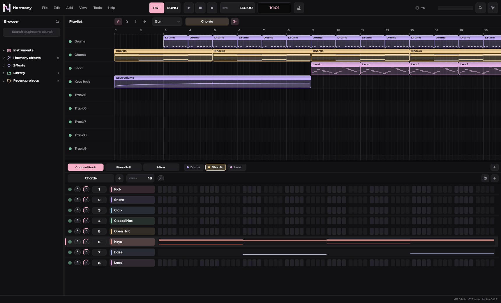
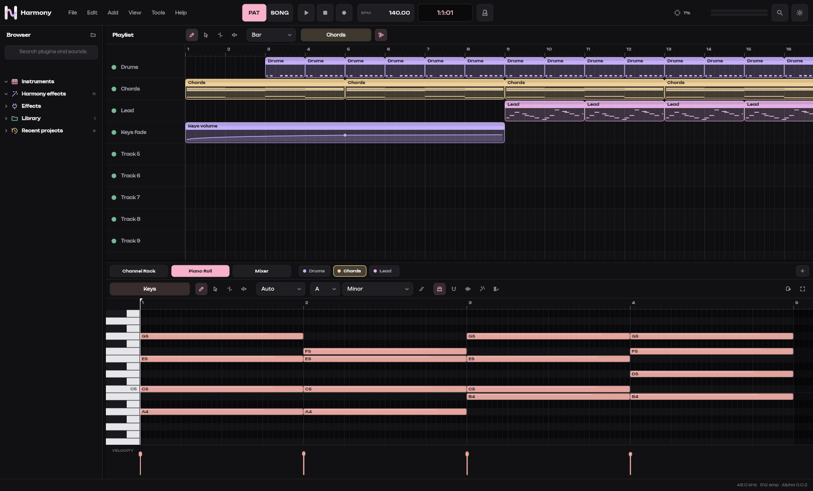
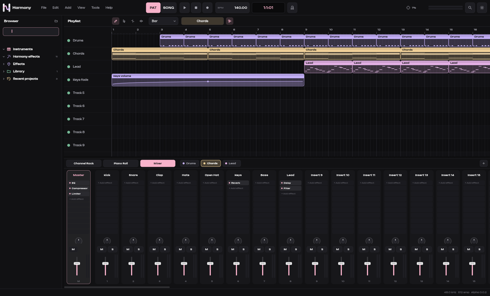

<p align="center">
  
</p>

<h1 align="center">Yannosay Harmony</h1>

<p align="center">
  A fast, dark, pattern-based digital audio workstation by Yannosay Productions.<br>
  <a href="https://harmony.yannosay.com">harmony.yannosay.com</a> ·
  <a href="https://github.com/Yannosay/harmony/releases/latest">Download for Windows</a>
</p>



## What it is

Harmony is a native C++20 DAW built on JUCE 8. It ships with **no built-in instruments**: bring
your own VST, VST3 and LV2 plugins, SoundFonts and samples. It does ship eleven studio effects.

- **Plugin hosting**: VST3, VST 2.x and LV2 instruments and effects, with out-of-process
  scanning so a crashing plugin can never take the DAW down, automatic plugin delay
  compensation, and plugin state saved with your project.
- **SoundFonts**: load any `.sf2` as a channel and pick presets right from the channel rack.
- **Sampler**: one-shot or pitched sample playback with high-quality interpolation.
- **Channel rack and step sequencer**, **pattern and song modes**, **playlist** with pattern
  and audio clips, **piano roll** with ghost notes, scale highlighting and scale lock.
- **Opens FL Studio projects** (`.flp`, FL 12.9 up to FL Studio 2026): channels, patterns, notes,
  the playlist with pattern and audio clips, tempo, track and insert names, routing, and FL
  effects mapped to Harmony effects. A report lists anything that needs a replacement.
- **MIDI in and out**: drop or paste MIDI (also MIDI copied in other apps), drag notes out of
  the piano roll as a `.mid`, or export the song or a pattern.
- **Follow chords**: write a bassline, arpeggio or melody that follows the chords in a pattern.
- **Mixer** with 64 inserts plus master, 10 effect slots each, mute, solo, pan and meters.
  Drag any effect from the browser onto a strip, including the master.
- **Built-in effects**: EQ with a live response curve, filter, compressor, look-ahead limiter,
  gate, oversampled saturator, reverb, tempo-synced delay, chorus, phaser and utility.
- **Automation clips** for channel and insert volume and pan, and any plugin parameter.
  Right-click a knob or fader, or use Automate in any plugin window. Points and curves are
  edited right in the playlist or in the automation editor.
- **Pattern bar**: every pattern one click away, drag patterns straight into the playlist.
- **Settings** for interface size, note previews, snapping, playhead behaviour, new project
  defaults, metronome level, audio devices and plugin folders.
- **Chord generator** with 15 progressions, smooth voice leading and arpeggio rhythms.
- **Drum generator** for 11 styles (trap, drill, house, techno, drum & bass and more).
- **Rendering** to WAV (16/24/32-bit float), FLAC, OGG Vorbis and AIFF, with stems,
  normalisation, dither and background rendering. Headless rendering from the command line.
- **Time machine**: automatic project snapshots you can open at any time, plus crash recovery.
- **Command palette** (`Ctrl+K`) for every action, FL-style shortcuts, smooth inertial
  scrolling and zooming everywhere.
- **Automatic updates** from the website and GitHub Releases, verified with SHA-256 before installing.
- Plugins receive the project tempo, time signature and transport position.





## Shortcuts

| Action | Keys |
|--------|------|
| Play / pause, stop | `Space`, `Ctrl+Space` |
| Pattern / song mode | `L` |
| Channel rack, piano roll, browser, mixer | `F6`, `F7`, `F8`, `F9` |
| Command palette | `Ctrl+K` |
| Render | `Ctrl+R` |
| Chord generator, drum generator | `Ctrl+G`, `Ctrl+Shift+G` |
| Draw, select, slice, mute tools | `P`, `E`, `C`, `T` |
| Duplicate, quantize, humanize | `Ctrl+B` or `Ctrl+D`, `Ctrl+Q`, `Alt+H` |
| Zoom, scroll, vertical zoom | `Ctrl+wheel`, `wheel` / `Shift+wheel`, `Alt+wheel` |
| Note velocity | `Alt+wheel` over a note or velocity stem (`Shift` for fine steps) |
| Settings | `Ctrl+,` |
| Maximise the piano roll, rack or mixer | `F12` |
| Import FL Studio project or MIDI, export MIDI | `Ctrl+Shift+I`, `Ctrl+Shift+M` |
| Time machine | `Ctrl+H` |

Press `F1` in Harmony for the complete list.

## Command line

```
Harmony.exe project.hmy                      open a project
Harmony.exe --render project.hmy out.wav     render without opening a window (wav, flac, ogg, aiff)
```

## Building

Requirements: CMake 3.25+, Ninja, and Visual Studio 2022 (MSVC) on Windows.

```
cmake -S . -B build -G Ninja -DCMAKE_BUILD_TYPE=Release
cmake --build build
build/HarmonyTests_artefacts/Release/HarmonyTests
```

The installer is built with Inno Setup 6. Its version always comes from the `VERSION` file:
`iscc /DAppVersion=<VERSION> /DAppVersionNumber=<MAJOR.MINOR.PATCH> installer/harmony.iss`.

## Releasing

1. Bump `VERSION` (the only place a version is written), commit, and push the matching tag (`v` + `VERSION`). The release workflow builds,
   tests and packages `YannosayHarmony-<version>-Setup-x64.exe` plus `SHA256SUMS.txt`.
2. Publish it on the website, which is also the primary update feed:

   ```
   cd website
   node scripts/sync-release.mjs path/to/YannosayHarmony-<VERSION>-Setup-x64.exe
   npm run deploy
   ```

`sync-release.mjs` writes `public/latest.json` (version, download URL, SHA-256). Every installed
copy of Harmony checks that manifest (falling back to GitHub Releases), downloads the new
installer in the background, verifies its SHA-256 and installs it silently when Harmony closes.

## License

Harmony is free software under the [GNU AGPL v3](LICENSE). Third-party components are
listed in [THIRD_PARTY_NOTICES.md](THIRD_PARTY_NOTICES.md).
